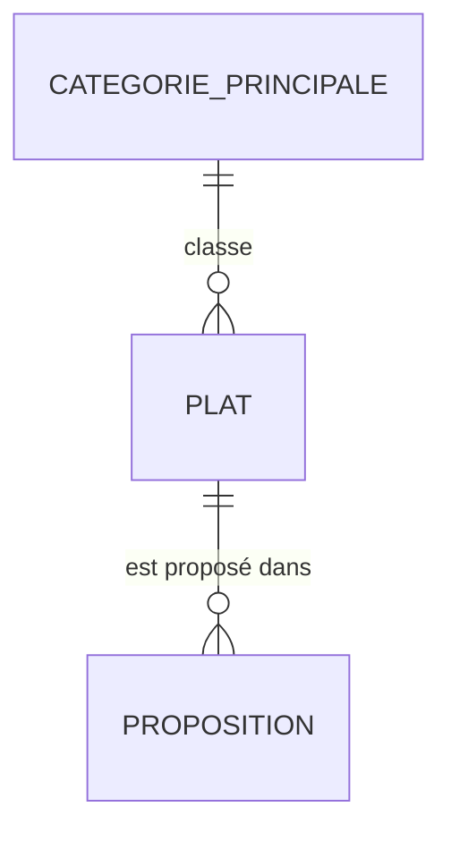

# Modélisation de la base de données

Ce document décrit le modèle de données de `menus_generator` : les tables, leurs contraintes, et la manière dont elles servent la qualité des propositions de repas. Les règles métier sont dans [PRD.md](../PRD.md) (§5.1 et §5.4).

Stack : SQLite via PDO, sur un hébergement privé (voir [CLAUDE.md](../CLAUDE.md)).

## Schéma des relations



- Une catégorie principale regroupe plusieurs plats.
- Un plat peut être proposé plusieurs fois dans le temps.
- Aucun menu n'est stocké : la table `proposition` ne garde qu'une ligne par plat proposé à un jour et un repas donnés.

## Tables

### `categorie_principale`

Table de référence. Elle contient la liste fermée du PRD §5.1 : pâtes, riz / céréales, viande, poisson, œufs, légumes, soupe, autre. La mettre en table plutôt qu'en `CHECK` permet d'ajouter une catégorie sans modifier le schéma.

| Colonne | Type | Contraintes |
|---|---|---|
| `id` | INTEGER | clé primaire |
| `libelle` | TEXT | NOT NULL, UNIQUE |

### `plat`

Cœur du modèle. Chaque plat porte les attributs que le générateur utilise pour filtrer et pondérer.

| Colonne | Type | Contraintes | Rôle |
|---|---|---|---|
| `id` | INTEGER | clé primaire | |
| `nom` | TEXT | NOT NULL | Nom affiché |
| `nom_normalise` | TEXT | NOT NULL, UNIQUE | Nom en minuscules sans accents, calculé côté PHP. Garantit l'unicité du PRD : `COLLATE NOCASE` ne gère pas les accents. |
| `convient_dejeuner` | INTEGER | 0 ou 1, défaut 1 | Le plat peut être proposé au déjeuner |
| `convient_diner` | INTEGER | 0 ou 1, défaut 1 | Le plat peut être proposé au dîner |
| `saison` | TEXT | `printemps_ete`, `automne_hiver` ou `hybride` | Saison du plat (PRD §5.4) |
| `type` | TEXT | `classique` ou `vegetarien` | Végétarien ou non (PRD §5.1) |
| `niveau` | TEXT | `rapide` ou `elabore` | Défini par l'utilisateur, jamais calculé |
| `categorie_principale_id` | INTEGER | NOT NULL, clé étrangère vers `categorie_principale` | Sert à la règle de variété déjeuner / dîner |
| `poids` | INTEGER | 1 à 3, défaut 2 | Préférence : 1 = rarement, 2 = normal, 3 = favori. Sert au tirage pondéré. |
| `cree_le` | TEXT | NOT NULL | Date ISO 8601 |
| `modifie_le` | TEXT | NOT NULL | Date ISO 8601 |

Contrainte de table : au moins un des deux repas doit être autorisé (`convient_dejeuner = 1 OR convient_diner = 1`). « Les deux » correspond à deux colonnes à 1, ce qui est plus simple à filtrer qu'un champ à trois valeurs.

### `proposition`

Journal des plats proposés. Il sert à éviter les redites d'une semaine à l'autre. Il ne stocke ni menu ni recette.

| Colonne | Type | Contraintes | Rôle |
|---|---|---|---|
| `id` | INTEGER | clé primaire | |
| `plat_id` | INTEGER | NOT NULL, clé étrangère vers `plat`, ON DELETE CASCADE | Supprimer un plat efface son historique, ce qui respecte la suppression libre du PRD §5.1 |
| `date_menu` | TEXT | NOT NULL | Lundi de la semaine concernée |
| `jour` | INTEGER | 1 à 7 | Jour de la semaine (1 = lundi) |
| `repas` | TEXT | `dejeuner` ou `diner` | Type de repas |
| `origine` | TEXT | `suggestion` ou `choix_libre` | Plat proposé par le générateur, ou choisi par l'utilisateur |
| `cree_le` | TEXT | NOT NULL | Date ISO 8601 |

Index :
- `(plat_id, date_menu DESC)` : retrouver la dernière apparition d'un plat ;
- `(date_menu)` : purger les lignes anciennes.

## Règles d'intégrité

- Pas de doublon de nom : garanti par `nom_normalise UNIQUE`.
- Pas de valeur hors liste pour `saison`, `type`, `niveau`, `repas`, `origine` : garanti par les `CHECK`.
- Pas de plat sans repas autorisé : garanti par la contrainte de table sur `plat`.
- Pas de proposition orpheline : garanti par la clé étrangère, avec `PRAGMA foreign_keys = ON` à activer à chaque connexion (SQLite ne l'applique pas par défaut).

## Comment le modèle sert la qualité des propositions

Le générateur travaille en trois temps.

1. **Filtrage dur** (règles du PRD, non négociables) :
   - le plat est autorisé pour le repas demandé (`convient_*`) ;
   - sa saison est celle du moment, ou `hybride` ;
   - il n'est pas déjà pris dans la semaine.
2. **Priorités douces** (à respecter si la base le permet) :
   - niveau selon le jour : `rapide` du lundi au vendredi, `elabore` le week-end ;
   - part de plats hybrides entre 30 et 40 % du menu ;
   - part de végétariens selon le réglage ; « quelques-uns » = un repas végétarien au maximum par semaine, « majoritairement » = au moins 8 repas sur 14 ;
   - `categorie_principale` différente entre le déjeuner et le dîner d'un même jour.
3. **Tirage pondéré** : chaque plat éligible reçoit un poids égal à `poids` multiplié par un facteur de fraîcheur. Ce facteur est déduit de `proposition` : un plat proposé récemment est pénalisé, un plat jamais proposé est favorisé.

La rétention de `proposition` est fixée à 8 semaines : les lignes plus anciennes sont supprimées pour garder le journal petit.

## Décisions

- **Moment d'écriture dans `proposition`** : à la validation du menu, via un bouton « Valider le menu ». Pas à chaque génération, pour ne pas enregistrer les suggestions rejetées. Une nouvelle validation remplace les lignes de la semaine concernée, pour que le journal corresponde toujours au dernier menu validé.

## Points à décider

- **Force de la pénalité de fraîcheur** et **durée de rétention** (8 semaines proposé).

## DDL SQLite

Ce DDL est repris à l'identique dans [`config/schema.sql`](../config/schema.sql), qui est la version exécutée : la commande `php bin/console app:db:init` l'applique sur la base. Toute modification du modèle se fait dans les deux fichiers.

Le fichier est rejouable : `IF NOT EXISTS` sur les tables et les index, `INSERT OR IGNORE` sur les catégories, pour que `app:db:init` puisse être relancée sans rien détruire. La contrainte de table sur les repas autorisés vient après la dernière colonne : SQLite refuse une contrainte de table placée entre deux colonnes.

```sql
CREATE TABLE IF NOT EXISTS categorie_principale (
  id INTEGER PRIMARY KEY,
  libelle TEXT NOT NULL UNIQUE
);

CREATE TABLE IF NOT EXISTS plat (
  id INTEGER PRIMARY KEY,
  nom TEXT NOT NULL,
  nom_normalise TEXT NOT NULL UNIQUE,
  convient_dejeuner INTEGER NOT NULL DEFAULT 1 CHECK (convient_dejeuner IN (0, 1)),
  convient_diner INTEGER NOT NULL DEFAULT 1 CHECK (convient_diner IN (0, 1)),
  saison TEXT NOT NULL CHECK (saison IN ('printemps_ete', 'automne_hiver', 'hybride')),
  type TEXT NOT NULL CHECK (type IN ('classique', 'vegetarien')),
  niveau TEXT NOT NULL CHECK (niveau IN ('rapide', 'elabore')),
  categorie_principale_id INTEGER NOT NULL REFERENCES categorie_principale (id),
  poids INTEGER NOT NULL DEFAULT 2 CHECK (poids BETWEEN 1 AND 3),
  cree_le TEXT NOT NULL,
  modifie_le TEXT NOT NULL,
  CHECK (convient_dejeuner = 1 OR convient_diner = 1)
);

CREATE TABLE IF NOT EXISTS proposition (
  id INTEGER PRIMARY KEY,
  plat_id INTEGER NOT NULL REFERENCES plat (id) ON DELETE CASCADE,
  date_menu TEXT NOT NULL,
  jour INTEGER NOT NULL CHECK (jour BETWEEN 1 AND 7),
  repas TEXT NOT NULL CHECK (repas IN ('dejeuner', 'diner')),
  origine TEXT NOT NULL CHECK (origine IN ('suggestion', 'choix_libre')),
  cree_le TEXT NOT NULL
);

CREATE INDEX IF NOT EXISTS idx_proposition_plat_date ON proposition (plat_id, date_menu DESC);
CREATE INDEX IF NOT EXISTS idx_proposition_date ON proposition (date_menu);

-- Données de référence du PRD §5.1
INSERT OR IGNORE INTO categorie_principale (libelle) VALUES
  ('pâtes'),
  ('riz / céréales'),
  ('viande'),
  ('poisson'),
  ('œufs'),
  ('légumes'),
  ('soupe'),
  ('autre');
```
